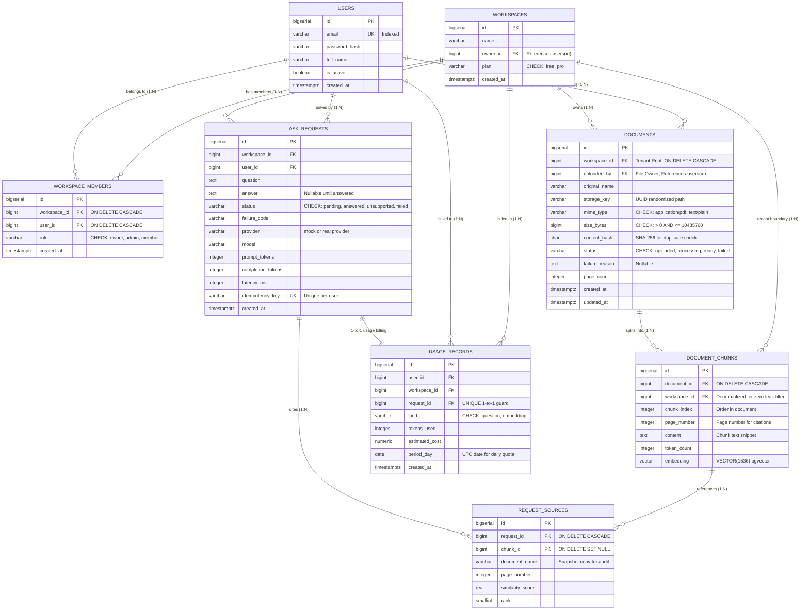

# 03 — Database Design Specification & ERD Guide

> **Project:** AI SaaS Workspace  
> **Prepared for:** FalconXoft Weekend 2 Internship Evaluation  
> **Mandatory Rule per PDF:** *"Lucidchart ERD with PK/FK, data types, cardinality, constraints and indexes; include schema.sql or migrations and editable URL. Address file ownership and request usage records."*

---

## 1. Lucidchart ERD URL & Associated Files

* **Editable Lucidchart ERD URL:** **USER ACTION REQUIRED** — import/redraw `03 - database-design.mmd`, share it from the submitter account, then paste the authentic edit URL.
* **Exported PDF Deliverable:** `03 - database-design.pdf`
* **Executable SQL Script:** [schema.sql](file:///d:/Muaz/Programming/FX%20internship/Weekend%20Assessments/Week%20Two/AI%20SaaS%20Workspace/deliverables/01_AI_SaaS/schema.sql) *(Included in this directory)*

---

## 2. Entity-Relationship Diagram (Mermaid Visual ERD)

---

## 3. Critical Integrity Constraints & Index Architecture

### 3.1 File Ownership & Tenant Isolation
* **`uploaded_by` (FK to `users.id`):** Preserves immutable file ownership. Even in a shared workspace, only the user who uploaded the document or a workspace `admin`/`owner` can delete it.
* **Denormalized `workspace_id` on `document_chunks`:** Eliminates expensive table joins during vector search. The search index query directly applies:
  `WHERE workspace_id = :ws`.

### 3.2 Duplicate Prevention & Idempotency Constraints
* **`UniqueConstraint(workspace_id, content_hash)` on `documents`:** Prevents users from uploading the exact same document twice into the same workspace, saving database disk space and redundant embedding costs.
* **`UniqueConstraint(user_id, idempotency_key)` on `ask_requests`:** Enforces API-level idempotency so network retries never double charge daily question quotas.
* **`UniqueConstraint(request_id)` on `usage_records`:** Guarantees a strictly 1-to-1 relationship between an answered question and its billing charge.

### 3.3 High-Performance Indexing Strategy
1. **`HNSW` Vector Index:** `CREATE INDEX idx_chunks_embedding ON document_chunks USING hnsw (embedding vector_cosine_ops);` — Provides logarithmic sub-linear vector nearest-neighbor search.
2. **Compound Index `documents(workspace_id, status)`:** Accelerates document list and processing queue queries.
3. **Compound Index `ask_requests(user_id, created_at DESC)`:** Provides instant loading of the user's history log.
4. **Compound Index `usage_records(user_id, period_day)`:** Ensures sub-millisecond daily quota verification.

---

## 4. How to Export to `03 - database-design.pdf` for Submission

1. Open [Lucidchart](https://www.lucidchart.com) and select the **Entity Relationship Diagram (ERD)** shape library.
2. Recreate the 9 tables showing field names, data types, and PK/FK markers.
3. Draw connecting relationship lines with exact crow's foot cardinality (`1:N`, `1:1`).
4. Add a notes panel highlighting **File Ownership** (`uploaded_by`) and **Unique 1-to-1 Usage Billing** (`request_id`).
5. Export as PDF (`03 - database-design.pdf`).
