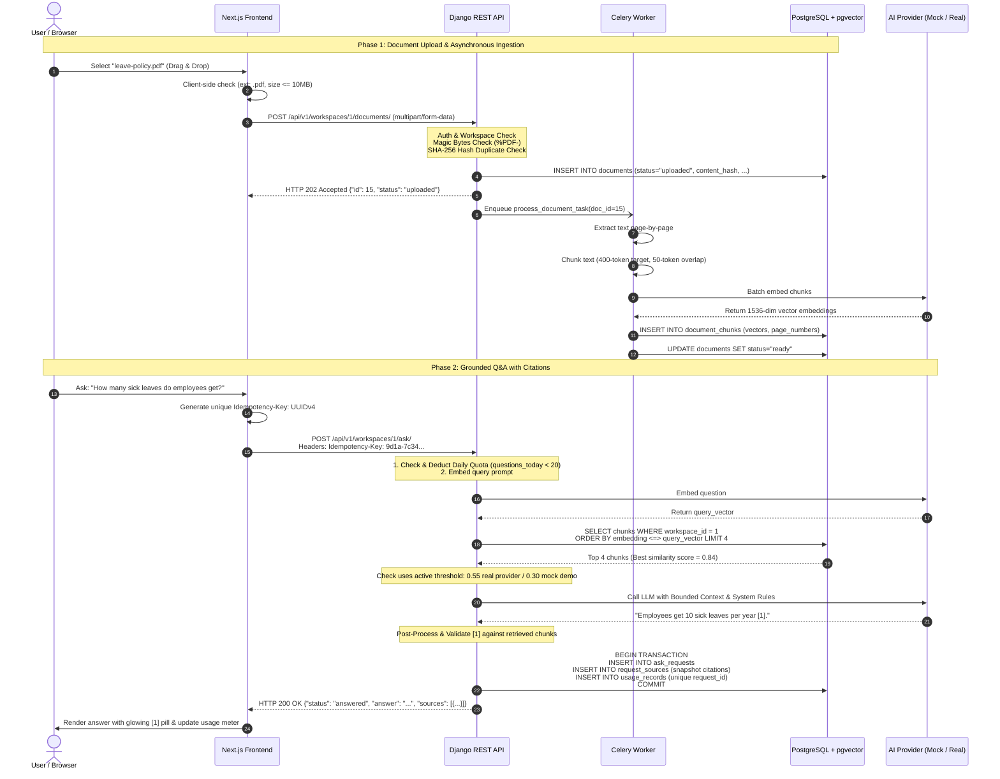
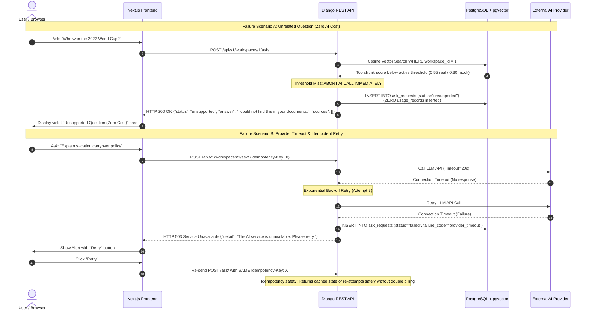

# 04 — API Workflows & Sequence Diagrams Specification

> **Project:** AI SaaS Workspace  
> **Prepared for:** FalconXoft Weekend 2 Internship Evaluation  
> **Mandatory Rule per PDF:** *"Lucidchart sequence/API flows covering success and failure; include api-spec.md or openapi.yaml. Document routes, methods, auth, request/response examples, validation, errors and idempotency/retry behavior where relevant."*

---

## 1. Lucidchart URL & OpenAPI Specification

* **Editable Lucidchart URL:** **USER ACTION REQUIRED** — import/redraw `04 - api-workflows.mmd`, share it from the submitter account, then paste the authentic edit URL.
* **Exported PDF Deliverable:** `04 - api-workflows.pdf`
* **Complete OpenAPI 3.0 Specification:** [openapi.yaml](file:///d:/Muaz/Programming/FX%20internship/Weekend%20Assessments/Week%20Two/AI%20SaaS%20Workspace/deliverables/01_AI_SaaS/openapi.yaml) *(Included in this directory)*

---

## 2. Sequence Diagram 1: Success Journey (Upload ➔ Ingestion ➔ Q&A with Citations)



---

## 3. Sequence Diagram 2: Failure & Exception Workflows



---

## 4. Key Request / Response Payloads

### 4.1 Grounded Q&A Success (HTTP 200)
```json
// POST /api/v1/workspaces/1/ask/
// Headers: Authorization: Bearer <token>, Idempotency-Key: 9d1a7c34-2b6e-4f0a-8c11-5e2f7a6b9c10
{
  "question": "How many sick leaves do employees get per year?"
}

// Response (HTTP 200 OK)
{
  "request_id": 120,
  "status": "answered",
  "answer": "Employees get 10 sick leaves per year [1].",
  "sources": [
    {
      "n": 1,
      "document": "leave-policy.pdf",
      "page": 3,
      "score": 0.842,
      "snippet": "Each employee is entitled to 10 days of paid sick leave per calendar year."
    }
  ],
  "usage": {
    "questions_today": 1,
    "daily_limit": 20
  },
  "latency_ms": 210
}
```

### 4.2 Unsupported Question (HTTP 200, status="unsupported")
```json
{
  "request_id": 121,
  "status": "unsupported",
  "answer": "I could not find this in your documents.",
  "sources": []
}
```

### 4.3 Daily Quota Limit Exceeded (HTTP 429)
```json
{
  "detail": "Daily question limit reached.",
  "resets_at": "2026-10-27T00:00:00Z"
}
```

---

## 5. How to Export to `04 - api-workflows.pdf` for Submission

1. In Lucidchart, use the **UML Sequence** shape library.
2. Recreate the lifelines (`User`, `Next.js Frontend`, `Django API`, `Celery Worker`, `PostgreSQL`, `AI Provider`).
3. Add the arrows with sequence numbers and notes.
4. Export as PDF (`04 - api-workflows.pdf`).
